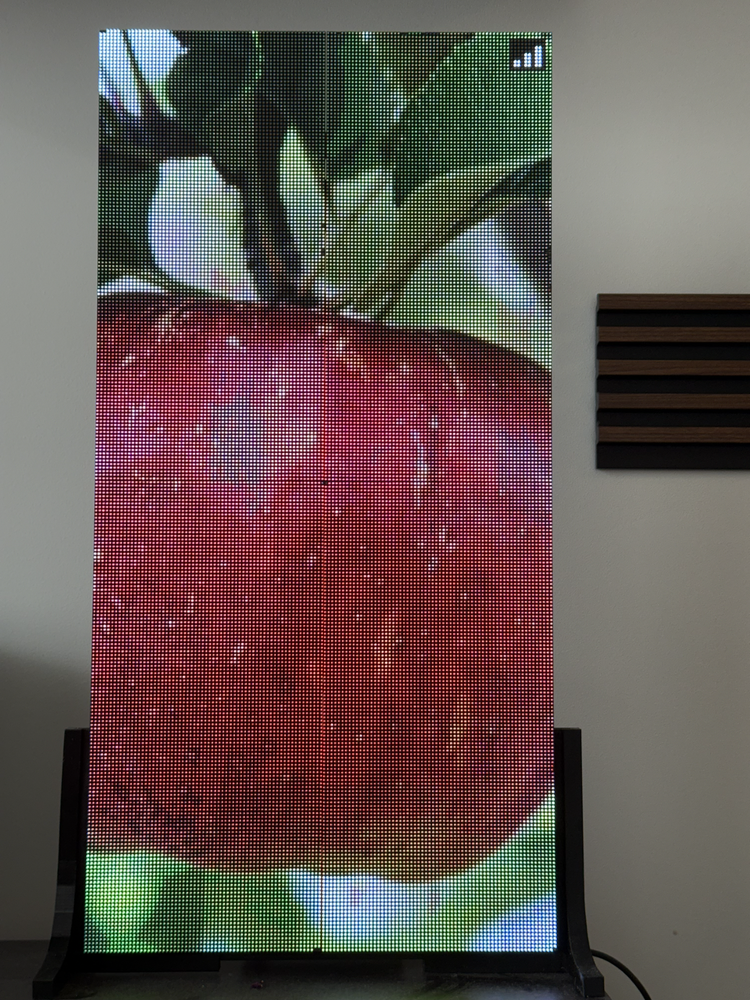
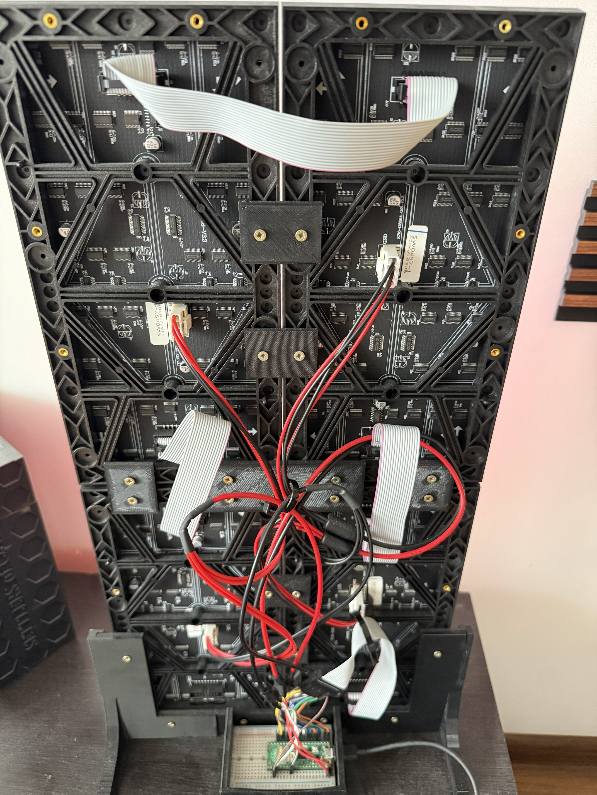

# HUB75 Multi-Panel WiFi Controller

## Guides

| Topic | Guide |
| --- | --- |
| Browser tabs, upload options, placement and previews | [Web interface](web/README.md) |
| Saved collections, slideshow, settings and pagination | [Media library](docs/MEDIA-LIBRARY.md) |
| Python uploads, transfer messages and failure handling | [Video uploads](docs/VIDEO-UPLOAD.md) |
| SD wiring, storage API, verification and throughput | [Storage](docs/MEMORY-MANAGER.md) |
| Binary descriptors and container compatibility | [Media metadata](docs/MEDIA-METADATA.md) |
| Compressed frame layout and bounded decoder | [JPEG video](docs/JPEG-VIDEO.md) |
| Frame buffers, scan isolation and FPS | [Display](docs/DISPLAY.md) |
| Core ownership, connectivity, recovery and serial status | [Runtime](docs/RUNTIME.md) |
| Custom controller routes and examples | [HTTP API](docs/HTTP-API.md) |

<table>
  <tr>
    <td width="50%">
      
    </td>
    <td width="50%">
      A Raspberry Pi Pico 2 W controller for a 128x256 HUB75 LED display made from four daisy-chained 64x128 panels, with animation playback and live image uploads over WiFi/TCP. This README covers the hardware build, usage, and internal architecture.
      <br><br>
      <a href="readmeAssets/WalkInTheForest.mp4">Watch the display demo (MP4)</a>
      <br><br>
      <strong>NOTE: The wave-like color artifacts in the video are caused by the interaction between the panel's refresh method and the camera's shutter. They are not visible in person; the display looks closer to the still Apple image.</strong>
    </td>
  </tr>
</table>

## Table of Contents

- [1. Overview](#1-overview)
  - [What This Project Is](#what-this-project-is)
  - [Forked From](#forked-from)
  - [Hardware Used](#hardware-used)
  - [What It Does](#what-it-does)
  - [Ways to Get Content Onto the Panel](#ways-to-get-content-onto-the-panel)
- [2. Hardware / Wiring](#2-hardware--wiring)
  - [Faulty HUB75 Connector Byte-Reorder Quirk](#faulty-hub75-connector-byte-reorder-quirk)
- [3. Usage](#3-usage)
  - [WiFi connection](#wifi-connection)
  - [Build & Flash Quickstart](#build--flash-quickstart)
  - [USE_ANIMATION flag](#use_animation-flag)
  - [Flashing Your Own Image or Animation](#flashing-your-own-image-or-animation)
  - [Python Utility Setup](#python-utility-setup)
  - [Uploading an Image Over TCP](#uploading-an-image-over-tcp)
  - [Uploading a Video to microSD](#uploading-a-video-to-microsd)
- [4. Implementation Details / Architecture](#4-implementation-details--architecture)
  - [Source folders](#source-folders)
  - [Program Flow](#program-flow)
  - [Driver Overview](#driver-overview)
  - [WiFi State Machine](#wifi-state-machine)
- [5. Credits / License](#5-credits--license)
  - [Attribution](#attribution)
  - [License](#license)

# 1. Overview

## What This Project Is

A Raspberry Pi Pico 2 W controller drives four HUB75 panels as one 128 × 256 canvas. It
displays built-in content, plays photos/videos saved on microSD, and accepts browser or
Python uploads over the local Wi-Fi network.

## Forked From

Panel output uses the DMA/PIO/BCM driver from
[JuPfu/hub75](https://github.com/JuPfu/hub75), with controller code for panel mapping,
saved media, playback and network uploads. See [third-party
notices](THIRD_PARTY_NOTICES.md) for attribution and licensing.

## Hardware Used

The controller targets a Raspberry Pi Pico 2 W and four daisy-chained 64 × 128 P2
panels, arranged as a synchronized 128 × 256 canvas. A microSD reader provides storage
for the saved photo/video libraries.

## What It Does

Boot restores the selected saved photo, video or slideshow. If saved content is
unavailable, the panel displays its built-in image or animation. The Wi-Fi icon and IP
address identify the local connection; browser and Python uploaders save content for
display and restoration after restart.

## Ways to Get Content Onto the Panel
These Python scripts handle content:
- `imageToRGB888ArrayConverter.py` / `mp4ToRGB888ArrayConverter.py` - convert an image or video into a C header with a byte array, included via `defines.h` under the `USE_ANIMATION` flag. This becomes the default image/animation flashed into firmware.
- `sendImageOverTCP.py` - uploads a full photo over TCP, or a compact fitted photo through HTTP.
- `sendVideoOverTCP.py` - converts and uploads a video to microSD, waits for verification, then starts looping playback.

Scripts accept settings at the top of each file and command-line overrides. The built-in
web page uploads photos and videos, manages saved collections and controls display
settings; see [web usage](web/README.md).

# 2. Hardware / Wiring

<table>
  <tr>
    <td width="50%">
      
    </td>
    <td width="50%">
      <strong>NOTE: Use this wiring photo as a reference. Pin assignments and wiring must match your panels and controller configuration.</strong>
      <br><br>
      Pin mapping / wiring config lives in <a href="third_party/hub75/src/hub75.hpp">third_party/hub75/src/hub75.hpp</a>. Pins can be changed by editing the defines there, but must follow the rules noted in the comments above each define (e.g. color/row-select pins must be consecutive).
    </td>
  </tr>
</table>

## Faulty HUB75 Connector Byte-Reorder Quirk

The panels used by this configuration have incorrect physical colour annotations on
their HUB75 connectors. The software compensates with the `IMAGE_RED_BYTE_OFFSET`,
`IMAGE_GREEN_BYTE_OFFSET` and `IMAGE_BLUE_BYTE_OFFSET` definitions in
`src/config/defines.h`. This byte reordering preserves the intended colours for that
wiring. For panels with standard RGB order, set RED=0, GREEN=1 and BLUE=2 instead.

# 3. Usage

## WiFi connection
Copy `.env.example` to `.env` in the repository root, then replace every placeholder
with your local settings.

- `PICO_IP` - Pico's current LAN address, used by the Python upload script only.
- `PICO_PORT` - TCP image-upload port. CMake gives this value to the firmware listener, and the Python upload script connects to the same port.
- `WIFI_SSID` - WiFi network name compiled into the firmware.
- `WIFI_PASSWORD` - WiFi password compiled into the firmware.
- `WIFI_AP_SSID` - required private direct Pico network name (1–32 bytes).
- `WIFI_AP_PASSWORD` - required private direct network password (8–63 bytes).
- `WIFI_GATEWAY_PROBE_PORT` - local gateway TCP diagnostic port

CMake generates `build/generated/networkConfig.h` from `.env`. Do not edit or commit
that generated file; a normal build recreates it when it is missing or when `.env`
changes. The Python upload script reads `PICO_IP` and `PICO_PORT` directly from the same
`.env` file.

The Pico also creates its own password-protected Wi-Fi network. On your phone,
join the network named by `WIFI_AP_SSID` using your private `WIFI_AP_PASSWORD`
from `.env`, then open `http://192.168.4.1/` in Safari or another browser. Both
hotspot settings are required; there are no built-in credentials. The direct network
serves the same page, API and image/video upload ports as the home address, without
a router or Internet connection. A phone may label it as a network without Internet.

Both interfaces run together. The panel shows home Wi-Fi and its IP at the
bottom-right, and the hosted network and its IP at the bottom-left. Each icon
indicates that interface's controller availability; disconnected interfaces show
a red icon without borrowing the other interface's address.
Home connection retries retain hotspot clients and the independent SD playback
session. The Pico does not share your home Internet through its hotspot. See
[connectivity and recovery](docs/RUNTIME.md#wi-fi-and-direct-hotspot).

## Build & Flash Quickstart
Configure `.env` as described above before the first build. This project is built and
flashed using VS Code with the [Raspberry Pi Pico
extension](https://marketplace.visualstudio.com/items?itemName=raspberry-pi.raspberry-pi-pico).
Import the project through the extension, then use its UI buttons to compile and
run/flash - no manual CLI setup required.

With CMake and Ninja on PATH, the `web-upload` preset selects `pico2_w` and
`MinSizeRel`. SDK/toolchain discovery follows the project configuration:

```powershell
cmake --preset web-upload
cmake --build --preset web-upload
```

Flash `build/web-upload/hub75.uf2` to the board. `HUB75_VERBOSE_LOGS` defaults to
`OFF`; pass `-DHUB75_VERBOSE_LOGS=ON` during configuration for detailed diagnostics.

## USE_ANIMATION flag
The `USE_ANIMATION` flag in `src/config/defines.h` controls what gets built into flash:
`0` builds a single still image, `1` builds a multi-frame animation.

## Flashing Your Own Image or Animation
1. Run `imageToRGB888ArrayConverter.py` (still image) or `mp4ToRGB888ArrayConverter.py` (video/animation), pointing it at your source file and adjusting settings like animation delay/fps as needed.
2. The script generates a `.h` file in `imagesVideos/`.
3. `#include` that new file in `src/config/defines.h` under the `USE_ANIMATION` block - that's the only required change.

## Python Utility Setup
Install the Python packages used by the image, video, and TCP upload scripts:

```sh
python -m pip install -r utilityScripts/requirements.txt
```

## Uploading an Image Over TCP
1. After flashing, the default image/animation should be visible with a small white WiFi icon in the top right corner, confirming the Pico is connected (also checkable in your router's admin panel).
2. Look up the Pico's IP address from your router.
3. Update `PICO_IP` in `.env` if the address differs from the value used during setup. Keep `PICO_PORT` equal to the firmware upload-listener port.
4. Set your image path (`IMAGE_PATH`) in `utilityScripts/sendImageOverTCP.py`, then run the script.
5. The new image should be uploaded and displayed by the panel.

With a usable microSD card, completed TCP photo uploads save automatically. The raw
photo `ACK` confirms receipt into RAM; SD publication completes in the foreground. Use
the browser's saved-and-verified confirmation when durable-save acknowledgement is
required.

## Uploading a Video to microSD

To upload a clip from Python:

```powershell
python utilityScripts/sendVideoOverTCP.py "clip.mp4" --fps 30 --seconds 10
```

The video service uses TCP port 5002. Configure its target IP in the script or with
`--ip`. The uploader prepares the selected RGB565/RGB888/JPEG encoding, sends bounded
chunks and waits for **Saved and verified**. The Pico selects the saved clip for looping
playback and restores the selection after restart. `--seconds` limits source conversion;
`--output "clip.h75v"` retains the prepared file for later uploads. See [video
usage](docs/VIDEO-UPLOAD.md) for settings, formats and failure handling.

# 4. Implementation Details / Architecture

## Source folders

```text
src/
  config/       Application, network, storage and filesystem configuration
  core/         Shared-core scheduling and serial logging
  display/      CPU frame, rendering, overlays, FPS and submission implementations
  network/      Wi-Fi state machine, network worker and TCP uploads
  http/         HTTP server, request parsing and browser upload sessions
    api/        Controller commands and API discovery information
  sd/           MemoryManager, card access, file storage, CRC and prefetch
  media/        Metadata, playback, libraries and slideshow
    jpeg/       JPEG decoder wrapper, input pipe and worker
third_party/    Bundled HUB75, SD filesystem and JPEG dependencies
```

Each module keeps its `.cpp` implementations directly in its folder and its `.hpp`
declarations in an `include/` subfolder. Nested modules such as `media/jpeg/` and
`http/api/` follow the same layout.

Application headers use paths relative to `src/`, such as
`network/include/WifiConnectionClass.hpp` and `sd/include/MemoryManagerClass.hpp`. The
separate `config/` include directory also supplies the `ffconf.h` and `lwipopts.h` names
expected by the filesystem and network libraries. The main entry point remains at the
repository root; the panel driver remains in `third_party/hub75/`.

## Program Flow

Core 0 starts the panel, restores selected SD media or the built-in fallback, then owns
frame preparation, storage jobs and publication. Core 1 owns Wi-Fi and upload transports
and can decode JPEG when its foreground network work is idle. Uploads hold shared media
resources until save, verification or cancellation. See [runtime ownership and
recovery](docs/RUNTIME.md).

## Driver Overview

PIO/DMA outputs rows and bit-planes while a short Core 0 interrupt advances the scan.
The driver uses two scan buffers and swaps them at complete-scan boundaries. Foreground
image preparation can pause while the scanner displays the last submitted frame. See
[display buffers and scan isolation](docs/DISPLAY.md).

## WiFi State Machine

Local networking advances through disconnected, link/IP available and ready service
states, with packet reachability tracked separately. Wi-Fi and SD recover independently.
See [connection states and recovery](docs/RUNTIME.md#wi-fi-recovery).

# 5. Credits / License

## Attribution
- [JuPfu/hub75](https://github.com/JuPfu/hub75) by Jürgen Pfundt and Christoph Mair - the DMA/PIO/BCM HUB75 driver core this project is forked from.
- [Pimoroni](https://github.com/pimoroni) - `pico_graphics`, `bitmap_fonts`, and `hershey_fonts` libraries, vendored under `libraries/`.

## License
This project's original code is licensed under the [MIT License](LICENSE). Vendored and
derived components remain subject to their respective licenses; see
[THIRD_PARTY_NOTICES.md](THIRD_PARTY_NOTICES.md).
